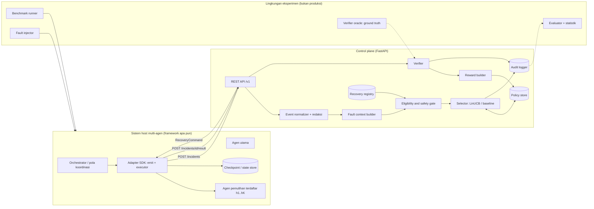
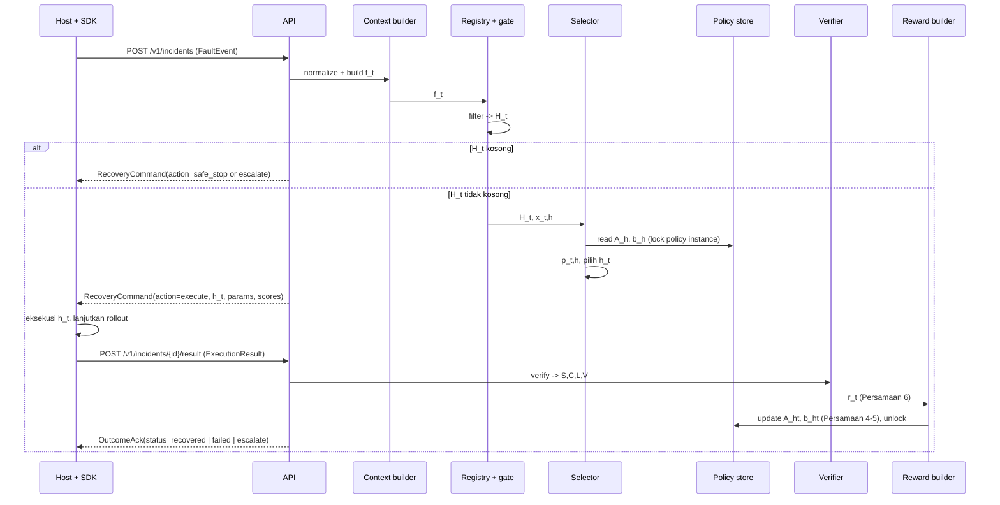

# Implementation Plan: Lapisan Kendali Pemulihan Eksternal (Self-Healing LinUCB)

Dokumen ini menerjemahkan Usulan Tesis "Dynamic Fault Tolerance dan Self-Healing pada Sistem Multi-Agen LLM dengan Pemilihan Adaptif Berbasis Algoritma LinUCB" (Bab III) menjadi rencana implementasi yang dapat dieksekusi. Basis layanan: **FastAPI**.

Sumber acuan: `Usulan_Tesis_Dynamic_Fault_Tolerance_Self_Healing_LinUCB.docx` (versi 13 Oktober 2026), Gambar 1 (arsitektur) dan Gambar 2 (diagram urutan).

---

## 0. Ringkasan

| Item | Keputusan |
|---|---|
| Bentuk sistem | Satu layanan **control plane** (FastAPI) + **Adapter SDK** (pustaka Python) yang dipasang di sisi host multi-agen |
| Prinsip integrasi | Host tetap mengeksekusi; control plane hanya menerima fault context, memilih kandidat, menerima hasil, memverifikasi, memperbarui kebijakan |
| Algoritma | Disjoint LinUCB (Persamaan 1-5), reward Persamaan 6, `d = 20` fitur |
| Pembanding | B0-B4, P, P-D, P-F (Tabel 7) diimplementasikan sebagai `Selector` dengan antarmuka yang sama |
| Host uji | (1) Synthetic host untuk sanity check, (2) host referensi berbasis framework terbuka dengan checkpoint, (3) host kedua untuk bukti klaim framework-agnostic |
| Disiplin | TDD wajib: setiap task di bawah diawali test yang gagal |

Pemetaan Bab III ke modul kode:

| Bagian usulan | Modul |
|---|---|
| Tabel 4 (informasi minimum adaptor) | `arclayer/contracts/events.py` |
| Tabel 5 (komponen) | `arclayer/core/*` |
| Persamaan 1-5 | `arclayer/policy/linucb.py` |
| Persamaan 6 | `arclayer/core/reward.py` |
| Algoritme 1 | `arclayer/core/orchestrator.py` |
| Gambar 2 | `arclayer/api/routes/incidents.py` + `arclayer_sdk/client.py` |
| Tabel 6 | `configs/candidates/*.yaml` |
| Tabel 7 | `arclayer/policy/baselines.py` + `arclayer/policy/linucb.py` |
| Tabel 8, III.3.4 | `experiments/` + `analysis/` |

---

## 1. Gotcha dan Risiko (baca dulu)

Bagian ini sengaja ditaruh di depan karena beberapa poin mengubah desain, bukan sekadar detail implementasi.

### 1.1 Fitur yang konstan akibat gerbang kelayakan (mempengaruhi Persamaan 2 dan H2)

Vektor `g(t,h)` di usulan memuat (a) indikator kecocokan kelas fault dan (b) indikator kecocokan prasyarat state. Gerbang kelayakan juga menyaring berdasarkan prasyarat. Akibatnya:

- **Indikator prasyarat** selalu bernilai 1 untuk setiap kandidat yang lolos gerbang. Fitur ini konstan, kolinear dengan bias, dan tidak membawa informasi.
- **Indikator kelas** akan bernasib sama apabila gerbang juga menyaring berdasarkan kelas yang didukung.

Rekomendasi:
1. Gerbang hanya menyaring hal yang bersifat **keras**: izin (allowlist), prasyarat state yang wajib, biaya maksimum terhadap sisa anggaran, status kandidat aktif.
2. **Kelas yang didukung** diperlakukan sebagai **fitur lunak** (`class_match`), bukan filter. Ini juga konsisten dengan B2 yang memakai kolom kelas sebagai pemetaan, sehingga perbedaan P vs B2 benar-benar menguji pembelajaran.
3. Ganti indikator prasyarat biner dengan **skor kelengkapan prasyarat opsional** (rasio prasyarat opsional yang terpenuhi, misalnya artefak bukti tersedia sebagian), atau buang fitur tersebut dan sesuaikan `d`.

Ini perlu diputuskan sebelum kode fitur dibekukan (lihat Pertanyaan Terbuka Q1).

### 1.2 One-hot + bias = kolinear

One-hot kelas fault dan one-hot pola orkestrasi masing-masing berjumlah 1, sama dengan suku bias. Dengan regularisasi ridge (`A = λI`) solusi tetap ada, jadi tidak fatal, tetapi interpretasi `θ` per fitur jadi ambigu. Untuk audit/interpretabilitas, simpan juga versi tanpa satu kategori referensi sebagai opsi analisis. Tidak perlu diubah di jalur utama.

### 1.3 Definisi `S_t` per insiden vs post-repair pass rate per tugas

Metrik utama dihitung per tugas, sedangkan reward dihitung per insiden. Perlu aturan eksplisit:

- Setelah kandidat `h_t` dieksekusi, host **melanjutkan tugas** sampai (a) tugas selesai, (b) muncul insiden baru, atau (c) anggaran/batas waktu habis.
- `S_t = 1` hanya jika (a) terjadi dan verifikator/benchmark menyatakan lolos.
- Jika (b) terjadi, `S_t = 0` untuk insiden `t`, dan insiden `t+1` adalah putaran baru (sesuai Algoritme 1 langkah 16).
- Jika `N_max = 1`, rantai ini tidak terjadi dan definisi menjadi sederhana.

Konsekuensi: reward tidak benar-benar "segera" pada tugas panjang; ia tertunda sampai rollout selesai. Ini tetap sah sebagai bandit karena tidak ada propagasi nilai ke keputusan lain, tetapi harus ditulis eksplisit di Bab IV.

### 1.4 Kebocoran ground truth ke kandidat

Paper DoVer memberi jawaban acuan ke pengusul hipotesis. Di sini verifikator butuh ground truth GAIA, tetapi kandidat (perencana ulang, peninjau verifikasi) **tidak boleh** melihatnya. Desain: ground truth hanya masuk lewat `VerifierOracle` yang didaftarkan harness eksperimen ke control plane, tidak pernah ada di `FaultEvent`, `FaultContext`, atau `RecoveryCommand`. Ada test khusus untuk ini (T-SEC-02).

### 1.5 Biaya eksperimen berpasangan

8 kondisi x N insiden x S seed, masing-masing butuh replay host dari checkpoint plus rollout sampai selesai. Dengan rollout GAIA, ini mahal. Opsi penghematan (Section 9.4): **outcome matrix**. Jalankan setiap kandidat yang lolos gerbang sekali per insiden, cache hasilnya, lalu simulasikan semua kebijakan dan seed secara offline. Syarat validitasnya:

- Hasil eksekusi kandidat tidak bergantung pada riwayat kebijakan. Ini benar untuk `N_max = 1`. Untuk `N_max > 1`, fitur "jumlah insiden sebelumnya" dan insiden lanjutan bergantung pada pilihan sebelumnya, sehingga outcome matrix hanya valid untuk insiden pertama per tugas.
- Determinisme pada suhu nol **tidak dijamin** pada API LLM komersial. Ukur variansinya dulu (Fase 5, task E-01) sebelum mengandalkan cache.

Rekomendasi: outcome matrix sebagai jalur utama dengan `N_max = 1`, plus subset kecil eksekusi online penuh untuk memvalidasi bahwa hasil offline dan online konsisten.

### 1.6 Ketersediaan StateMAS

Per usulan, artefak StateMAS belum ditemukan. Rencana ini **tidak** bergantung pada StateMAS: host referensi dibangun sendiri (Fase 4) dan adapter StateMAS hanya dikerjakan bila artefak muncul.

### 1.7 Konkurensi pembaruan kebijakan

LinUCB bersifat sekuensial: keputusan `t+1` harus melihat pembaruan `t`. Jika beberapa host mengirim insiden paralel ke policy yang sama, urutan pembaruan menjadi tidak deterministik dan eksperimen tidak dapat direproduksi. Desain:

- State kebijakan dikunci per `policy_instance_id` (asyncio lock + transaksi DB).
- Untuk eksperimen, setiap `(kondisi, seed)` punya `policy_instance_id` sendiri dan aliran insidennya diproses berurutan oleh harness.
- Hasil yang dikirim dua kali (retry jaringan) ditolak lewat `Idempotency-Key`.

### 1.8 Hasil yang tidak pernah kembali

Jika host crash dan tidak pernah mengirim hasil, insiden ditandai `censored` setelah TTL. **Tidak ada pembaruan** `A_h, b_h` untuk insiden censored (memperbarui dengan reward 0 akan membuat bias). Dilaporkan terpisah.

### 1.9 Tie-breaking

Pada awal, beberapa kandidat bisa punya skor sama. `argmax` NumPy selalu memilih indeks pertama sehingga urutan registri menjadi bias tersembunyi. Gunakan tie-break acak ber-seed per `policy_instance_id`.

---

## 2. Keputusan Teknis

| Lapisan | Pilihan | Alasan | Alternatif yang ditolak |
|---|---|---|---|
| Bahasa | Python 3.12 | Ekosistem LLM/agen dan statistik | Go: ekosistem agen dan analisis lebih tipis |
| API | FastAPI + Uvicorn | Permintaan pengguna; validasi Pydantic v2 menghasilkan skema OpenAPI otomatis untuk kontrak adaptor | gRPC: lebih ketat tapi menambah friksi saat integrasi ke host berbagai framework |
| Skema | Pydantic v2 | Satu sumber kebenaran untuk kontrak, ekspor JSON Schema untuk adaptor non-Python | dataclass: tanpa validasi |
| Penyimpanan | SQLite (WAL) via SQLAlchemy 2.x async + Alembic | Cukup untuk skala eksperimen, file tunggal mudah diarsip sebagai artefak replikasi | Postgres: opsional bila multi-proses, tidak dibutuhkan di awal |
| Numerik | NumPy (float64) | `d = 20`, operasi matriks kecil | PyTorch: berlebihan |
| Embedding | `sentence-transformers`, model dibekukan dan versinya dicatat, dimensi 384 | Dipakai bersama oleh fitur cosine LinUCB dan B4 (syarat usulan) | Embedding API berbayar: biaya dan non-determinisme |
| Konfigurasi | YAML + Pydantic Settings | Registri kandidat dan konfigurasi eksperimen bisa di-commit dan di-hash | |
| Test | pytest, pytest-asyncio, httpx `AsyncClient`, hypothesis (property test untuk LinUCB) | | |
| Statistik | SciPy, statsmodels | McNemar, Wilcoxon, koreksi Holm | |
| Observabilitas | structlog (JSON) + endpoint `/metrics` sederhana | Audit logger terpisah dari log operasional | |
| Paket | `uv` + `pyproject.toml`, lock file di-commit | Reproduksibilitas | |

Catatan: versi pustaka dikunci di lock file pada awal Fase 0; plan ini sengaja tidak menyebut nomor versi spesifik.

---

## 3. Arsitektur

### 3.1 Komponen



### 3.2 Urutan satu insiden (mengikuti Gambar 2)



Catatan desain: lock policy instance dipegang dari keputusan sampai hasil diterima **hanya dalam mode eksperimen sekuensial** (`strict_sequential=true`). Dalam mode layanan, keputusan dibaca tanpa menahan lock dan pembaruan diterapkan saat hasil tiba (urutan pembaruan dicatat di audit). Mode eksperimen wajib `strict_sequential=true`.

### 3.3 Mesin status insiden

```
RECEIVED -> CONTEXT_BUILT -> GATED -> { SAFE_STOPPED | ESCALATED | DECIDED }
DECIDED -> AWAITING_RESULT -> VERIFIED -> UPDATED -> { RECOVERED | FAILED }
AWAITING_RESULT -> CENSORED   (TTL habis, tanpa update)
```

Transisi ilegal menghasilkan HTTP 409. Mesin status ini diuji dengan test tabel transisi (T-CORE-09).

---

## 4. Struktur Repositori

```
recovery-control-layer/
  pyproject.toml
  uv.lock
  README.md
  configs/
    candidates/default.yaml        # Tabel 6
    gate/default.yaml              # aturan izin dan batas
    features/v1.yaml               # definisi fitur dan normalisasi (dibekukan)
    reward/default.yaml            # w_s=1, w_c=0.2, w_l=0.1, w_v=1
    experiments/*.yaml
  src/
    arclayer/                           # control plane
      api/
        app.py                     # FastAPI factory, lifespan
        deps.py                    # DI: db session, registry, selector factory
        routes/
          incidents.py
          candidates.py
          policies.py
          oracle.py                # hanya aktif bila ARCLAYER_MODE=experiment
          health.py
        errors.py
        security.py                # API key per host
      contracts/                   # Pydantic: satu sumber kebenaran kontrak
        events.py                  # FaultEvent (Tabel 4)
        context.py                 # FaultContext, FeatureVector
        candidates.py              # CandidateSpec
        commands.py                # RecoveryCommand, ScoreBreakdown
        results.py                 # ExecutionResult, VerificationResult, OutcomeAck
        enums.py                   # FaultClass, OrchestrationPattern, Action
      core/
        normalizer.py
        redaction.py
        context_builder.py
        features.py                # f_t dan g(t,h)
        embeddings.py              # wrapper model beku + cache
        registry.py
        gate.py
        verifier.py
        reward.py
        orchestrator.py            # Algoritme 1
        state_machine.py
      policy/
        base.py                    # Protocol Selector
        linucb.py                  # P, P-D, P-F
        baselines.py               # B0..B4
        factory.py
      store/
        models.py                  # SQLAlchemy ORM
        repo.py
        migrations/
      audit/
        logger.py
    arclayer_sdk/                       # dipasang di sisi host
      client.py                    # async + sync HTTP client
      adapter.py                   # Protocol HostAdapter, RecoveryExecutor
      runtime.py                   # loop: emit -> execute -> report
      inprocess.py                 # mode tanpa HTTP untuk unit test dan outcome matrix
    hosts/                         # host uji
      synthetic/                   # host sintetis untuk sanity
      langgraph_host/              # host referensi (kandidat, lihat Q2)
      second_host/                 # host kedua untuk klaim portabilitas
      statemas_adapter/            # hanya bila artefak tersedia
    injectors/
      tool_failure.py
      timeout.py
      tool_output_unused.py
      handoff_incomplete.py
      plan_error.py
      insufficient_verification.py
  experiments/
    runner.py                      # aliran insiden, seed, kondisi
    outcome_matrix.py
    calibrate.py                   # pemilihan alpha di data kalibrasi
    split.py                       # 20/80 berdasarkan task_id
  analysis/
    metrics.py
    stats.py                       # McNemar, bootstrap per tugas, Wilcoxon, Holm
    power.py
    report.py
  tests/
    unit/ integration/ e2e/ property/
```

Paket `arclayer_sdk` sengaja **tidak** mengimpor apa pun dari `arclayer.core`, hanya dari `arclayer.contracts`. Ini yang menjaga host tidak bergantung pada internal control plane, dan diuji oleh test impor (T-ARCH-01).

---

## 5. Kontrak Data (Pydantic)

Semua model memakai `model_config = ConfigDict(extra="forbid", frozen=True)` kecuali disebut lain. `extra="forbid"` mencegah adaptor diam-diam menyelipkan field internal framework, yang akan melanggar klaim framework-agnostic.

### 5.1 Enum

```python
class FaultClass(StrEnum):
    TOOL_FAILURE = "tool_failure"
    TIMEOUT = "timeout"
    TOOL_OUTPUT_UNUSED = "tool_output_unused"
    HANDOFF_INCOMPLETE = "handoff_incomplete"
    PLAN_ERROR = "plan_error"
    INSUFFICIENT_VERIFICATION = "insufficient_verification"

class OrchestrationPattern(StrEnum):
    CENTRALIZED = "centralized"
    SEQUENTIAL = "sequential"
    CONCURRENT = "concurrent"
    DECENTRALIZED = "decentralized"

class LabelSource(StrEnum):
    DETERMINISTIC = "deterministic"   # timeout, exception tool
    INJECTOR = "injector"
    ATTRIBUTION = "attribution"       # prosedur atribusi beku

class Action(StrEnum):
    EXECUTE = "execute"
    SAFE_STOP = "safe_stop"
    ESCALATE = "escalate"
```

Daftar kelas final diturunkan dari data (Batasan Masalah 2). Enum ini dikunci per versi `features/vN.yaml`; menambah kelas berarti versi fitur baru dan policy baru.

### 5.2 `FaultEvent` (Tabel 4)

```python
class FaultEvent(BaseModel):
    schema_version: Literal["1.0"]
    # identitas eksekusi dan langkah
    run_id: str
    task_id: str
    step_index: int = Field(ge=0)
    step_total_estimate: int | None = None   # untuk posisi relatif langkah
    occurred_at: datetime
    # agen dan pola
    active_agent: str
    agent_role: str
    orchestration: OrchestrationPattern
    # kelas fault
    fault_class: FaultClass | None           # None = tidak diketahui
    fault_confidence: float | None = Field(default=None, ge=0, le=1)
    label_source: LabelSource
    fault_description: str = Field(max_length=4000)  # untuk embedding cosine
    # state dan checkpoint
    last_messages_summary: str = Field(max_length=4000)
    checkpoint_id: str | None
    checkpoint_restorable: bool
    available_artifacts: list[str] = []      # nama artefak bukti, bukan isinya
    # tool
    tool_name: str | None = None
    tool_error_code: str | None = None
    tool_duration_ms: int | None = None
    # anggaran
    budget_remaining_cost: float = Field(ge=0)
    budget_remaining_tokens: int | None = None
    time_remaining_ms: int = Field(ge=0)
    prior_incidents_in_task: int = Field(ge=0)
    # integrasi
    host_id: str
    policy_instance_id: str
    host_capabilities: list[str]             # mis. ["rollback", "replan", "retry_step"]
```

Kelompok "Kandidat dan metadata" pada Tabel 4 **tidak** dikirim ulang tiap insiden; host cukup mengirim `host_capabilities`, sedangkan metadata kandidat ada di registri. Ini mengurangi duplikasi dan risiko inkonsistensi.

### 5.3 `CandidateSpec` (registri, Tabel 6)

```python
class CandidateSpec(BaseModel):
    candidate_id: str                         # "h1_retry"
    version: str
    description: str                          # di-embed untuk g(t,h)
    capabilities: list[str]
    supported_classes: list[FaultClass] | Literal["*"]
    required_preconditions: list[Precondition]   # filter keras
    optional_preconditions: list[Precondition] = []  # fitur lunak
    required_host_capabilities: list[str]
    max_cost: float = Field(gt=0)             # dalam satuan biaya ternormalisasi
    max_latency_ms: int = Field(gt=0)
    permissions: list[str]                    # harus subset allowlist gate
    verifier_id: str                          # rujukan ke verifier terdaftar
    enabled: bool = True
```

`Precondition` adalah enum tertutup (`STEP_REPEATABLE`, `TOOL_STATUS_AVAILABLE`, `ORCHESTRATOR_MESSAGE_ACCESS`, `STATE_SUMMARY_AVAILABLE`, `EVIDENCE_ARTIFACT_AVAILABLE`, `CHECKPOINT_AVAILABLE`), masing-masing punya fungsi evaluasi murni terhadap `FaultContext`. Fungsi eksekusi kandidat **tidak** ada di sini, karena eksekusi milik host (lihat 7.1).

Contoh `configs/candidates/default.yaml`:

```yaml
- candidate_id: h1_retry
  version: "1"
  description: Menjalankan ulang langkah gagal pada agen yang sama
  capabilities: [retry_step]
  supported_classes: "*"
  required_preconditions: [STEP_REPEATABLE]
  required_host_capabilities: [retry_step]
  max_cost: 0.15
  max_latency_ms: 60000
  permissions: [rerun_step]
  verifier_id: benchmark_task_pass
- candidate_id: h6_guided_rollback
  version: "1"
  description: Kembali ke checkpoint sebelum fault dengan panduan perbaikan satu langkah
  capabilities: [rollback, guided_repair]
  supported_classes: [plan_error, handoff_incomplete]
  required_preconditions: [CHECKPOINT_AVAILABLE]
  required_host_capabilities: [rollback]
  max_cost: 0.40
  max_latency_ms: 180000
  permissions: [load_checkpoint, inject_guidance]
  verifier_id: benchmark_task_pass
# h2..h5 mengikuti Tabel 6
```

### 5.4 `RecoveryCommand`

```python
class ScoreBreakdown(BaseModel):
    candidate_id: str
    estimate: float        # theta_h' x
    bonus: float           # alpha * sqrt(x' A^-1 x)
    score: float
    features: list[float]  # x_t,h, untuk audit

class RecoveryCommand(BaseModel):
    incident_id: UUID
    action: Action
    candidate_id: str | None
    parameters: dict[str, JsonScalar]     # mis. target checkpoint_id, guidance_template_id
    verification_conditions: list[str]
    scores: list[ScoreBreakdown]          # kosong untuk baseline non-skor
    excluded: list[GateRejection]         # kandidat yang ditolak gate + alasan
    reason: str
    deadline_ms: int
```

### 5.5 `ExecutionResult`, `VerificationResult`, `OutcomeAck`

```python
class ExecutionResult(BaseModel):
    incident_id: UUID
    candidate_id: str
    terminal: Literal["task_completed", "new_incident", "budget_exhausted", "executor_error"]
    final_answer: str | None              # untuk verifier benchmark
    cost_used: float = Field(ge=0)
    tokens_used: int = Field(ge=0)
    latency_ms: int = Field(ge=0)
    actions_performed: list[str]          # untuk cek pelanggaran izin
    artifacts: dict[str, str] = {}
    next_incident_hint: bool = False

class VerificationResult(BaseModel):
    S: Literal[0, 1]
    C: float = Field(ge=0, le=1)          # min(cost/cap, 1)
    L: float = Field(ge=0, le=1)          # min(latency/cap, 1)
    V: Literal[0, 1]
    details: dict[str, str]

class OutcomeAck(BaseModel):
    incident_id: UUID
    status: Literal["recovered", "failed", "escalate"]
    reward: float
    policy_updated: bool
```

`V = 1` bila `actions_performed` memuat aksi di luar `permissions` kandidat, atau batas biaya/latensi kandidat dilampaui. Ini pengaman kedua sesuai usulan; pengaman pertama adalah gate.

Semua skema diekspor ke `contracts/schema/*.json` (JSON Schema) agar adaptor non-Python bisa memvalidasi.

---

## 6. API FastAPI

Prefix `/v1`. Autentikasi: header `X-API-Key` per host (disimpan hash). Mode `ARCLAYER_MODE` = `service` atau `experiment`.

| Method | Path | Fungsi | Catatan |
|---|---|---|---|
| POST | `/v1/incidents` | Terima `FaultEvent`, kembalikan `RecoveryCommand` | Langkah 1-8 Algoritme 1 |
| POST | `/v1/incidents/{id}/result` | Terima `ExecutionResult`, kembalikan `OutcomeAck` | Wajib `Idempotency-Key`; langkah 9-16 |
| GET | `/v1/incidents/{id}` | Detail + audit insiden | |
| GET | `/v1/candidates` | Daftar registri | |
| POST | `/v1/candidates` | Daftar kandidat baru | Ditolak saat policy instance aktif sedang `frozen_registry=true` |
| PATCH | `/v1/candidates/{id}` | Ubah `enabled` | Perubahan versi = kandidat baru |
| POST | `/v1/policies` | Buat policy instance (`kind`, `params`, `seed`, `feature_version`) | `kind` ∈ B0..B4, P, P_D, P_F |
| GET | `/v1/policies/{id}` | State ringkas (n per kandidat, norma θ) | |
| POST | `/v1/policies/{id}/freeze` | Bekukan pembaruan (untuk P-F) | |
| POST | `/v1/policies/{id}/snapshot` | Simpan salinan A, b | Artefak replikasi |
| POST | `/v1/oracle/{task_id}` | Daftarkan ground truth | **Hanya** `ARCLAYER_MODE=experiment`; router tidak dipasang di mode service |
| GET | `/healthz`, `/metrics` | Liveness, counter | |

Kode error: `409` transisi status ilegal atau hasil ganda dengan payload berbeda, `422` validasi skema, `423` policy terkunci (mode strict sequential, ada insiden belum selesai), `404` insiden tidak dikenal.

Kerangka `app.py`:

```python
def create_app(settings: Settings) -> FastAPI:
    app = FastAPI(title="Recovery Control Layer", version="0.1.0", lifespan=lifespan)
    app.include_router(incidents.router, prefix="/v1")
    app.include_router(candidates.router, prefix="/v1")
    app.include_router(policies.router, prefix="/v1")
    if settings.mode == "experiment":
        # Router oracle sengaja hanya dipasang di mode eksperimen agar ground truth
        # tidak pernah bisa disuntikkan di layanan biasa.
        app.include_router(oracle.router, prefix="/v1")
    app.include_router(health.router)
    return app
```

---

## 7. Desain Komponen

### 7.1 Adapter SDK (sisi host)

```python
class RecoveryExecutor(Protocol):
    candidate_id: str
    async def execute(self, cmd: RecoveryCommand, ctx: HostContext) -> ExecutionResult: ...

class HostAdapter(Protocol):
    host_id: str
    capabilities: list[str]
    def to_fault_event(self, native: Any) -> FaultEvent: ...
    def executors(self) -> dict[str, RecoveryExecutor]: ...
```

`runtime.py` menyediakan satu fungsi yang dipanggil host saat fault terdeteksi:

```python
async def handle_fault(native_event, adapter, client) -> OutcomeAck:
    event = adapter.to_fault_event(native_event)
    cmd = await client.post_incident(event)
    if cmd.action is not Action.EXECUTE:
        return await client.report_stop(cmd)
    executor = adapter.executors()[cmd.candidate_id]
    result = await executor.execute(cmd, HostContext.current())
    return await client.post_result(cmd.incident_id, result)
```

Dua transport dengan antarmuka sama:
- `HttpClient`: produksi/integrasi lintas proses.
- `InProcessClient`: memanggil `Orchestrator` langsung tanpa HTTP. Dipakai untuk unit test dan outcome matrix supaya overhead HTTP tidak masuk ke metrik latensi.

Gotcha: latensi `L_t` harus diukur **di sisi host** (dari mulai eksekusi kandidat sampai rollout berhenti), bukan di control plane, karena control plane tidak melihat waktu eksekusi.

### 7.2 Event normalizer dan redaksi

- Validasi `FaultEvent` (Pydantic).
- Redaksi: pola API key, token bearer, email, path home, URL dengan query `token=`/`key=`; diganti `[REDACTED:<type>]`. Diterapkan ke `fault_description`, `last_messages_summary`, `artifacts`.
- Truncation deterministik (bukan acak) ke batas panjang.
- Redaksi terjadi **sebelum** embedding dan sebelum audit, sehingga hasil embedding konsisten antara audit dan keputusan.

### 7.3 Fault context builder dan fitur (`features/v1.yaml`)

`f_t` (15 dimensi):

| Indeks | Fitur | Transformasi |
|---|---|---|
| 0-5 | One-hot kelas fault | Semua nol bila `fault_class=None` |
| 6 | Keyakinan kelas | `confidence` atau 1.0 untuk `DETERMINISTIC`/`INJECTOR`, 0 bila tidak ada |
| 7-10 | One-hot pola orkestrasi | |
| 11 | Posisi relatif langkah | `step_index / max(step_total_estimate, 1)`, clip 0..1; bila estimasi tidak ada, `min(step_index / step_cap, 1)` dengan `step_cap` dari kalibrasi |
| 12 | Insiden sebelumnya | `min(prior / N_max, 1)` |
| 13 | Checkpoint tersedia | `checkpoint_restorable` |
| 14 | Sisa anggaran | `budget_remaining_cost / budget_task_cap` |

`g(t,h)` (4 dimensi, setelah resolusi Gotcha 1.1):

| Indeks | Fitur | Transformasi |
|---|---|---|
| 15 | Cosine(embed(fault_description), embed(candidate.description)) | `(cos + 1) / 2` |
| 16 | Class match | 1 bila kelas ∈ supported atau supported = "*", 0 bila tidak, 0.5 bila kelas tidak diketahui |
| 17 | Rasio biaya | `min(max_cost / budget_remaining_cost, 1)` |
| 18 | Kelengkapan prasyarat opsional | rasio terpenuhi; 1 bila tidak ada prasyarat opsional |

Indeks 19: bias = 1. Total `d = 20`.

Varian P-D (ablasi H2): buang indeks 15-18 (deskripsi dan kapabilitas kandidat), `d = 16`. Pertanyaan definisi: apakah rasio biaya termasuk "kapabilitas kandidat"? Usulan menyebut P-D sebagai "tanpa fitur deskripsi dan kapabilitas"; rasio biaya bukan deskripsi/kapabilitas. Rekomendasi: P-D buang 15, 16, 18 dan pertahankan 17 agar ablasi hanya menguji deskripsi/kapabilitas (lihat Q3).

Pembekuan: `features/v1.yaml` di-hash (SHA-256) dan hash disimpan di setiap policy instance dan audit record. Policy menolak insiden dengan `feature_version` berbeda.

Embedding: cache embedding deskripsi kandidat saat registri dimuat; cache embedding fault berdasarkan hash teks. Model dimuat sekali di `lifespan`.

### 7.4 Registry

- Sumber: YAML saat startup + API. Disimpan di DB dengan `(candidate_id, version)` unik.
- Policy instance menyimpan snapshot daftar kandidat saat dibuat. Menambah kandidat di tengah eksperimen tidak memengaruhi instance yang sudah berjalan (Batasan Masalah 4: kandidat ditetapkan sebelum eksperimen).

### 7.5 Eligibility and safety gate

Fungsi murni: `gate(ctx, candidates, gate_cfg) -> (eligible, rejections)`. Aturan diterapkan berurutan, setiap penolakan memuat kode alasan:

1. `DISABLED`: `enabled=false`.
2. `PERMISSION_NOT_ALLOWED`: `permissions` bukan subset allowlist host/gate.
3. `HOST_CAPABILITY_MISSING`: `required_host_capabilities` bukan subset `host_capabilities`.
4. `PRECONDITION_UNMET`: salah satu `required_preconditions` gagal.
5. `OVER_BUDGET`: `max_cost > budget_remaining_cost` atau `max_latency_ms > time_remaining_ms`.
6. `INCIDENT_LIMIT`: `prior_incidents_in_task >= N_max` (semua kandidat ditolak, action `ESCALATE`).

`H_t` kosong: `ESCALATE` bila alasannya `INCIDENT_LIMIT` atau anggaran, `SAFE_STOP` selain itu. Aturan ini ditetapkan di `gate/default.yaml`.

Gate dipakai identik oleh **semua** kebijakan termasuk B1-B4 (syarat usulan: kandidat, verifikator, anggaran sama). B0 tidak memanggil gate dan selalu `SAFE_STOP` tanpa eksekusi.

Catatan B1: "retry pada agen yang sama" berarti selalu `h1_retry`. Bila `h1` tidak lolos gate (langkah tidak dapat diulang), B1 menghasilkan `SAFE_STOP`. Dicatat sebagai bagian hasil B1, bukan dikecualikan.

### 7.6 Selector

```python
class Selector(Protocol):
    kind: str
    def select(self, ctx: FaultContext, eligible: list[CandidateFeatures], rng: Generator) -> Selection: ...
    def update(self, candidate_id: str, x: np.ndarray, reward: float) -> None: ...
    def state(self) -> PolicyState: ...
```

| Kode | Implementasi |
|---|---|
| B0 | Tidak memilih; orchestrator mengembalikan `SAFE_STOP` |
| B1 | Selalu `h1_retry` bila eligible |
| B2 | Pemetaan statis kelas -> kandidat dari Tabel 6 (`configs/baselines/static_map.yaml`), dibekukan sebelum eksperimen; bila beberapa kandidat cocok, urutan prioritas tetap di file yang sama; kelas tidak diketahui -> `h1_retry` |
| B3 | Uniform acak dari `H_t` dengan RNG ber-seed |
| B4 | `argmax` cosine (fitur 15) dengan model embedding yang sama |
| P | Disjoint LinUCB, `d = 20` |
| P-D | Disjoint LinUCB, fitur kandidat dibuang |
| P-F | P yang diinisialisasi dari snapshot kalibrasi lalu `freeze` |

`update` pada baseline adalah no-op, tetapi dipanggil tetap supaya jalur kode sama.

### 7.7 LinUCB (`policy/linucb.py`)

```python
class DisjointLinUCB:
    def __init__(self, candidate_ids, d, alpha, lam, rng):
        self.A = {h: lam * np.eye(d) for h in candidate_ids}   # A_h = lambda I
        self.b = {h: np.zeros(d) for h in candidate_ids}        # b_h = 0

    def score(self, h, x):
        # Pakai solve, bukan inv eksplisit: lebih stabil secara numerik dan d=20
        # membuat biayanya dapat diabaikan. Sherman-Morrison tidak perlu di skala ini.
        A_inv_x = np.linalg.solve(self.A[h], x)
        theta = np.linalg.solve(self.A[h], self.b[h])           # Persamaan (1)
        est = float(theta @ x)
        bonus = self.alpha * float(np.sqrt(max(x @ A_inv_x, 0.0)))
        return est, bonus, est + bonus                          # Persamaan (2)

    def select(self, eligible):
        scored = [(h, *self.score(h, x)) for h, x in eligible]
        best = max(s for *_, s in scored)
        ties = [h for h, _, _, s in scored if np.isclose(s, best, rtol=0, atol=1e-12)]
        return self.rng.choice(ties), scored                    # Persamaan (3), tie-break ber-seed

    def update(self, h, x, r):
        if self.frozen:
            return
        self.A[h] += np.outer(x, x)                             # Persamaan (4)
        self.b[h] += r * x                                      # Persamaan (5)
```

Parameter: `λ` awal 0.45 dan `α` awal 0.675 (nilai Poon dkk. per usulan), lalu `α` final dipilih dari {0.1, 0.25, 0.5, 1} pada data kalibrasi (Section 9.3). Pertanyaan: apakah `λ` juga dikalibrasi? Usulan hanya menyebut `α`. Plan ini mengikuti usulan: `λ` tetap 0.45 (Q4).

Persistensi: `A` dan `b` disimpan sebagai JSON list float64 per `(policy_instance_id, candidate_id)` + counter `n_updates`. Setiap update dalam satu transaksi dengan penulisan audit record, sehingga tidak ada keadaan policy yang tidak tercatat.

Kandidat yang ditambahkan ke registri setelah policy dibuat tidak ikut (snapshot 7.4).

### 7.8 Verifier

Registri verifier berdasarkan `verifier_id`:

- `benchmark_task_pass`: membandingkan `final_answer` dengan ground truth dari `VerifierOracle` memakai normalisasi jawaban GAIA (quasi exact match). Hanya `S=1` bila `terminal == "task_completed"`.
- `step_check`: verifikasi lokal tanpa ground truth (mis. tool berhasil dipanggil, JSON valid). Untuk host sintetis dan uji integrasi.
- `llm_judge`: **hanya** analisis sensitivitas (III.3.4), tidak pernah sumber reward jalur utama.

Perhitungan `C`, `L`, `V` ada di verifier, bukan di host, agar host tidak dapat memanipulasi reward.

### 7.9 Reward builder

```python
def reward(v: VerificationResult, w: RewardWeights) -> float:
    return w.s * v.S - w.c * v.C - w.l * v.L - w.v * v.V   # Persamaan (6)
```

Bobot dari `reward/default.yaml` (1, 0.2, 0.1, 1). Validator konfigurasi memeriksa invarian usulan: `w_c + w_l < w_s` dan `w_v >= w_s`. Untuk analisis sensitivitas, `w_c, w_l ∈ {0, 0.1, 0.2, 0.4}`. Catatan: kombinasi `w_c = 0.4, w_l = 0.4` tetap memenuhi `0.8 < 1`, jadi semua 16 kombinasi valid.

### 7.10 Audit logger

Satu record per insiden, append-only (tabel tanpa UPDATE/DELETE; diuji):

```
incident_id, policy_instance_id, policy_kind, seed, feature_version_hash,
registry_snapshot_hash, fault_context (teredaksi), eligible[], rejections[],
scores[] (estimate, bonus, score, x), chosen, action, reason,
execution_result, S, C, L, V, reward, A_b_checksum_before, A_b_checksum_after,
timestamps (received, decided, result_received, updated)
```

Checksum `A`/`b` sebelum dan sesudah memungkinkan replay audit untuk membuktikan urutan pembaruan.

---

## 8. Host Uji dan Injektor

### 8.1 Synthetic host (wajib, dibangun pertama)

Tujuan: membuktikan pipa end-to-end dan bahwa LinUCB belajar, **sebelum** menghabiskan biaya LLM. Bukan bukti tesis.

- Membangkitkan insiden dengan `fault_class`, `orchestration`, checkpoint, anggaran acak ber-seed.
- Probabilitas sukses tiap kandidat: `p(h | f) = sigmoid(θ*_h · x)` dengan `θ*_h` tersembunyi yang dibuat agar pemetaan statis tidak optimal (mis. `h3` lebih baik dari `h6` untuk `plan_error` hanya pada pola `sequential`).
- Biaya/latensi diambil dari distribusi per kandidat.

Test penerimaan: pada 2.000 insiden, rata-rata reward kumulatif P > B2 > B3 dan regret P sublinear secara empiris (kurva melandai). Bila gagal, ada bug sebelum masuk ke host nyata.

### 8.2 Host referensi (GAIA Level 1 / GAIA-Free)

Kebutuhan: (a) empat pola orkestrasi, (b) checkpoint per langkah dan kemampuan memuat ulang, (c) tool gratis saja (sejalan dengan GAIA-Free), (d) titik kait untuk deteksi fault dan injeksi.

Kandidat framework (pilih satu, Q2):
- **LangGraph**: checkpointer per langkah sudah tersedia di framework (recalling, not verified; cek dokumentasi versi yang dikunci). Memudahkan `h6` rollback.
- **Microsoft Agent Framework**: dipakai untuk membangun StateMAS menurut paper MARS (sesuai usulan), sehingga paling dekat ke protokol MARS bila StateMAS tidak rilis.
- **AG2/AutoGen**: dipakai DoVer untuk MathChat; DoVer melaporkan perlu pembungkus checkpoint sekitar seribu baris (sesuai usulan), jadi lebih mahal dibangun.

Rekomendasi: host referensi = framework dengan checkpoint native (kandidat LangGraph atau Microsoft Agent Framework), host kedua = framework lain dengan pola orkestrasi berbeda, untuk mendukung klaim portabilitas pada Batasan Masalah 6.

Implementasi per host:
1. `NativeFaultDetector`: timeout, exception tool, hasil injektor.
2. `HostAdapter.to_fault_event`: pemetaan state native ke `FaultEvent`.
3. Enam `RecoveryExecutor` (h1..h6). Prompt untuk h3 (perencana ulang), h4 (pelengkap handoff), h5 (peninjau verifikasi), h6 (panduan rollback) dibekukan sebagai template berversi.
4. Runner yang menjalankan satu tugas GAIA dan berhenti di insiden pertama atau sampai selesai.

### 8.3 Injektor fault

Setiap injektor: fungsi murni `inject(step, state, rng) -> InjectedState` + label (`fault_class`, `step_index`). Dijalankan dari checkpoint sebelum titik injeksi pada eksekusi yang berhasil (usulan III.3.3 jalur kedua).

| Kelas | Mekanisme injeksi |
|---|---|
| tool_failure | Tool mengembalikan error terstruktur atau argumen dikorupsi |
| timeout | Tool tidak merespons hingga batas waktu |
| tool_output_unused | Keluaran tool dihapus dari konteks agen berikutnya |
| handoff_incomplete | Pesan handoff dipotong atau field penting dihapus |
| plan_error | Satu langkah rencana orchestrator diganti langkah yang salah |
| insufficient_verification | Langkah verifikasi dilewati, jawaban diserahkan langsung |

Aturan "injeksi tidak aktif tidak dihitung" (III.3.3): injektor menulis `activated=true` hanya bila jalur eksekusi benar-benar melewati titik yang dimodifikasi. Insiden dengan `activated=false` dibuang sebelum kebijakan dijalankan.

### 8.4 Adapter StateMAS (kondisional)

Dikerjakan hanya bila artefak tersedia dan terverifikasi dapat dijalankan. Tugas: memetakan snapshot StateMAS ke `FaultEvent`, `checkpoint_id` ke snapshot, dan eksekutor ke API replay StateMAS.

---

## 9. Harness Eksperimen

### 9.1 Konfigurasi

```yaml
experiment_id: gaia_l1_main_v1
host: reference_host
benchmark: gaia_level1          # atau statemas_gaia_free
feature_version: v1
reward: default
n_max: 1
budget:
  per_incident_cost: 1.0
  per_task_cost: 3.0
  per_incident_timeout_ms: 300000
model:
  backbone: <dikunci saat Fase 5>
  temperature: 0
  max_tokens: <dikunci>
conditions: [B0, B1, B2, B3, B4, P, P_D, P_F]
seeds: [11, 23, 37, 41, 59]
split: { calibration: 0.2, evaluation: 0.8, by: task_id, seed: 7 }
alpha_grid: [0.1, 0.25, 0.5, 1.0]
lambda: 0.45
mode: outcome_matrix            # atau online
```

Konfigurasi di-hash dan hash disimpan di semua record. Konfigurasi yang dipakai untuk evaluasi dikomit sebelum data evaluasi dibuka (pre-registration lokal).

### 9.2 Split

`split.py`: bagi `task_id` unik dengan seed tetap, 20/80. Semua insiden dari satu `task_id` (lintas pola dan model) jatuh ke satu bagian. Test: tidak ada `task_id` di kedua bagian (T-EXP-01).

### 9.3 Kalibrasi

Di data kalibrasi:
1. Bekukan normalisasi (`step_cap`, `budget_task_cap`).
2. Untuk tiap `α` di grid, jalankan P pada semua seed; pilih `α` dengan reward kumulatif rata-rata tertinggi. Tie: pilih `α` terkecil.
3. Snapshot P setelah kalibrasi = inisialisasi P-F.
4. Studi pilot: estimasi proporsi pasangan sumbang P vs B2 untuk analisis daya (Section 10.2).

Pertanyaan desain: apakah P pada data evaluasi mulai dari nol atau dari snapshot kalibrasi? Usulan tidak eksplisit. Bila P mulai dari nol sementara P-F mulai dari snapshot, perbandingan P vs P-F tidak setara. Rekomendasi: P dan P-D mulai dari snapshot kalibrasi masing-masing, lalu terus belajar; P-F mulai dari snapshot yang sama dan dibekukan. Dengan begitu P vs P-F murni menguji pembelajaran daring (Q5).

### 9.4 Mode outcome matrix

1. Untuk setiap insiden evaluasi, jalankan host dari checkpoint untuk **setiap** kandidat yang lolos gate, satu kali. Simpan `ExecutionResult` dan `VerificationResult`.
2. Ukur determinisme: subset 10% insiden dijalankan ulang 3 kali per kandidat; laporkan proporsi `S` yang berubah. Bila > ambang yang ditetapkan sebelumnya (mis. 5%), simpan ketiga hasil dan ambil hasil secara acak ber-seed saat simulasi, atau beralih ke mode online.
3. Simulasikan setiap kondisi x seed: aliran insiden berurutan dengan urutan acak ber-seed yang sama untuk semua kondisi; selector memilih; hasil diambil dari matriks; update berjalan seperti biasa melalui `InProcessClient`.
4. Validasi: subset kecil dijalankan online penuh; bandingkan dengan simulasi.

Keuntungan: biaya LLM sekitar `|H_t|` eksekusi per insiden, bukan `8 x seeds`. Keterbatasan: hanya valid untuk `N_max = 1` (Gotcha 1.5). Wajib dicatat di Bab ancaman validitas.

### 9.5 Mode online

Untuk `N_max > 1` atau validasi. Setiap kondisi x seed menjalankan host sungguhan per insiden. Harness memproses satu insiden pada satu waktu per policy instance; paralelisme hanya antar instance.

---

## 10. Analisis

### 10.1 Metrik (Tabel 8)

`analysis/metrics.py` menghitung dari audit record:
- Post-repair pass rate per tugas (kriteria benchmark setelah recovery).
- Recovery success rate per insiden.
- Trial success rate bila satu kasus punya beberapa percobaan.
- Jumlah percobaan per tugas, token, biaya relatif terhadap B1.
- Latensi p50, p95.
- Tingkat pelanggaran.
- Reward kumulatif per urutan insiden per seed (kurva pembelajaran).
- Semua metrik dipecah per kelas fault dan per pola orkestrasi.
- Akurasi atribusi hanya bila `label_source = ATTRIBUTION`.

### 10.2 Statistik (`analysis/stats.py`, `analysis/power.py`)

| Uji | Implementasi | Catatan |
|---|---|---|
| McNemar (P vs B1..B4, P vs P-D, P vs P-F) | statsmodels, versi exact bila pasangan sumbang < 25 | Pada level tugas, per seed |
| Bootstrap CI 95% selisih proporsi | Resampling **per task_id** (cluster bootstrap), 10.000 iterasi, seed tercatat | Usulan III.3.4 |
| Wilcoxon signed-rank | SciPy, untuk biaya dan latensi berpasangan | Ukuran efek rank-biserial |
| Rasio odds pasangan sumbang | `b / c` dengan CI | |
| Koreksi Holm | Pada keluarga P vs {B1, B2, B3, B4} | Sesuai usulan |
| Batas atas pelanggaran | Clopper-Pearson satu sisi 95% bila nol pelanggaran | Untuk H3 |
| Daya | Formula McNemar (Connor) atau simulasi Monte Carlo dari proporsi sumbang pilot, target daya 0.8, alpha 0.05 | Dihitung sebelum data evaluasi dibuka |

Penggabungan seed: gotcha. Lima seed pada tugas yang sama tidak independen. Uji McNemar utama dilakukan per seed dan dilaporkan rentangnya, atau pada hasil mayoritas per tugas lintas seed. Tetapkan satu sebelum evaluasi (Q6). Bootstrap per tugas sudah menangani ketergantungan antar seed bila semua seed dimasukkan dalam cluster yang sama.

### 10.3 Laporan

`analysis/report.py` menghasilkan tabel CSV/LaTeX dan grafik (kurva reward kumulatif, bar post-repair pass rate per kelas dan pola, heatmap pilihan kandidat per kelas) dari audit DB. Semua angka di Bab IV harus dapat diregenerasi dari satu perintah.

---

## 11. Fase Implementasi

Setiap task: **Red** (tulis test yang gagal, jalankan, pastikan gagal karena alasan yang benar) -> **Green** (implementasi minimum) -> **Refactor**. Kolom "Test pertama" adalah test yang ditulis sebelum kode.

Estimasi minggu bersifat kasar dan mengasumsikan satu orang paruh waktu; sesuaikan dengan jadwal semester.

### Fase 0: Fondasi (minggu 1)

| ID | Task | Test pertama | DoD |
|---|---|---|---|
| F0-01 | Scaffold repo, `uv`, ruff, mypy strict, pytest, pre-commit | `test_smoke_import` | CI lokal hijau |
| F0-02 | `create_app` + `/healthz` | `test_healthz_returns_ok` | |
| F0-03 | Settings (`ARCLAYER_MODE`, DB URL, API key) | `test_oracle_router_absent_in_service_mode` | |
| F0-04 | DB + Alembic migrasi awal | `test_migration_up_down` | |
| F0-05 | Test arsitektur: `arclayer_sdk` tidak mengimpor `arclayer.core` | `T-ARCH-01` | |

### Fase 1: Kontrak (minggu 2)

| ID | Task | Test pertama |
|---|---|---|
| F1-01 | Enum + `FaultEvent` | `test_fault_event_rejects_extra_fields`, `test_confidence_bounds` |
| F1-02 | `CandidateSpec` + loader YAML Tabel 6 | `test_default_registry_has_six_candidates`, `test_unknown_precondition_rejected` |
| F1-03 | `RecoveryCommand`, `ExecutionResult`, `VerificationResult`, `OutcomeAck` | `test_execute_requires_candidate_id`, `test_C_L_clipped_range` |
| F1-04 | Ekspor JSON Schema | `test_schema_export_stable` (snapshot test) |

### Fase 2: Inti control plane (minggu 3-5)

| ID | Task | Test pertama |
|---|---|---|
| F2-01 | Redaksi | `test_redacts_bearer_token`, `test_redaction_idempotent` |
| F2-02 | Normalizer | `test_truncation_deterministic` |
| F2-03 | Fitur `f_t` | `test_f_dim_15`, `test_unknown_class_all_zero_onehot`, `test_features_in_unit_interval` (hypothesis) |
| F2-04 | Embedding wrapper + cache | `test_same_text_same_vector`, `test_model_version_recorded` (pakai model palsu di unit test) |
| F2-05 | Fitur `g(t,h)` + varian P-D | `test_g_dim_4`, `test_wildcard_class_match_is_one`, `test_pd_drops_expected_indices` |
| F2-06 | Hash versi fitur | `test_policy_rejects_mismatched_feature_hash` |
| F2-07 | Gate (6 aturan) | Satu test per kode penolakan + `test_gate_is_pure` + `test_empty_due_to_limit_escalates` |
| F2-08 | Verifier `step_check`, `benchmark_task_pass` | `test_new_incident_terminal_gives_S0`, `test_permission_violation_sets_V1` |
| F2-09 | Reward + validator bobot | `test_reward_eq6`, `test_success_always_positive_under_default_weights`, `test_violation_never_positive` (hypothesis) |
| F2-10 | State machine | `T-CORE-09` tabel transisi |
| F2-11 | Audit logger append-only | `test_audit_no_update_or_delete` |

### Fase 3: Kebijakan (minggu 5-6)

| ID | Task | Test pertama |
|---|---|---|
| F3-01 | `DisjointLinUCB` init | `test_init_A_lambda_I_b_zero` |
| F3-02 | Skor Persamaan 1-2 | `test_score_matches_closed_form` (bandingkan dengan `inv` eksplisit pada kasus kecil) |
| F3-03 | Update Persamaan 4-5 | `test_only_chosen_arm_updated`, `test_bonus_shrinks_after_repeated_same_x` |
| F3-04 | Tie-break ber-seed | `test_tie_break_not_always_first`, `test_same_seed_same_choice` |
| F3-05 | Freeze (P-F) | `test_frozen_policy_ignores_update` |
| F3-06 | Persistensi A, b | `test_roundtrip_float64_exact` |
| F3-07 | Baseline B0-B4 | Satu test perilaku per baseline; `test_b4_uses_same_embedding_model_as_p` |
| F3-08 | Factory dari `kind` | `test_factory_all_conditions_table7` |
| F3-09 | Property test LinUCB | Pada bandit linear sintetis, regret kumulatif P < B3 setelah N langkah (hypothesis, seed tetap) |

### Fase 4: API, orkestrator, SDK, host sintetis (minggu 6-8)

| ID | Task | Test pertama |
|---|---|---|
| F4-01 | `Orchestrator` (Algoritme 1) in-process | `test_algorithm1_happy_path`, `test_empty_Ht_safe_stop` |
| F4-02 | Route `/incidents` dan `/result` | `test_post_incident_returns_command`, `test_duplicate_result_same_key_idempotent`, `test_duplicate_result_different_payload_409` |
| F4-03 | Lock strict sequential | `test_second_incident_423_while_pending` |
| F4-04 | Censoring TTL | `test_censored_incident_no_update` |
| F4-05 | Routes candidates/policies/oracle | `test_oracle_not_leaked_into_command` (**T-SEC-02**: cari string ground truth di seluruh `RecoveryCommand` dan `FaultContext`) |
| F4-06 | SDK `HttpClient` + `InProcessClient` | Contract test yang sama dijalankan pada kedua transport |
| F4-07 | Host sintetis | `test_synthetic_host_deterministic_under_seed` |
| F4-08 | E2E sintetis | `test_linucb_beats_static_on_synthetic` (kriteria penerimaan 8.1) |

**Milestone M1 (akhir minggu 8):** pipa end-to-end berjalan pada host sintetis, semua kondisi Tabel 7 dapat dijalankan, audit dapat diregenerasi.

### Fase 5: Host referensi dan injektor (minggu 9-12)

| ID | Task | Test pertama |
|---|---|---|
| F5-01 | Keputusan framework (Q2) + spike checkpoint | Spike: simpan dan muat checkpoint pada tugas mainan, state identik |
| F5-02 | Host dengan 4 pola orkestrasi | `test_each_pattern_completes_toy_task` |
| F5-03 | Tool gratis + loader GAIA Level 1 | `test_gaia_answer_normalization` |
| F5-04 | Adapter `to_fault_event` | Contract test: event dari host lolos validasi skema |
| F5-05 | Executor h1..h6 + template prompt berversi | Per executor: test dengan LLM palsu (stub) untuk alur dan izin |
| F5-06 | 6 injektor + flag `activated` | `test_inactive_injection_flagged` per injektor |
| F5-07 | E-01: ukur determinisme suhu nol | Laporan variansi (bukan unit test) |
| F5-08 | Host kedua (framework berbeda) | Contract test SDK yang sama lolos |

**Milestone M2 (akhir minggu 12):** dua host nyata terintegrasi via SDK yang sama tanpa perubahan control plane. Ini bukti utama klaim framework-agnostic.

### Fase 6: Harness eksperimen (minggu 12-14)

| ID | Task | Test pertama |
|---|---|---|
| F6-01 | Split by task_id | **T-EXP-01** tidak ada kebocoran task_id |
| F6-02 | Urutan aliran ber-seed sama untuk semua kondisi | `test_same_order_across_conditions` |
| F6-03 | Kalibrasi alpha + snapshot | `test_alpha_selected_only_from_calibration_data` |
| F6-04 | Outcome matrix builder | `test_matrix_has_entry_per_eligible_candidate` |
| F6-05 | Simulator offline | `test_offline_equals_online_on_synthetic_host` |
| F6-06 | Pilot + analisis daya | `test_power_formula_against_known_values` |

### Fase 7: Eksekusi eksperimen dan analisis (minggu 14-16+)

| ID | Task |
|---|---|
| F7-01 | Bekukan semua konfigurasi, komit, catat hash |
| F7-02 | Jalankan kalibrasi |
| F7-03 | Bangun outcome matrix evaluasi |
| F7-04 | Simulasi semua kondisi x seed |
| F7-05 | Validasi subset online |
| F7-06 | Statistik + laporan; analisis sensitivitas bobot (16 kombinasi) dan verifier LLM |
| F7-07 | Paket artefak replikasi (kode, versi benchmark, daftar insiden, seed, konfigurasi model, jadwal injeksi, metadata kandidat, bobot, parameter LinUCB, audit teredaksi, skrip analisis) |

---

## 12. Strategi Pengujian

| Lapisan | Cakupan | Alat |
|---|---|---|
| Unit | Fitur, gate, reward, LinUCB, baseline, redaksi | pytest, hypothesis |
| Property | Invarian: fitur dalam [0,1], reward sukses > 0, pelanggaran ≤ 0, hanya arm terpilih berubah, determinisme ber-seed | hypothesis |
| Contract | Kontrak HTTP vs in-process identik; event dari setiap host lolos skema | pytest parametrize |
| Integrasi | FastAPI + SQLite nyata, alur Gambar 2 penuh | httpx `AsyncClient` |
| E2E | Host sintetis, kemudian host referensi dengan LLM stub | |
| Keamanan | Oracle tidak bocor, redaksi, router oracle absen di mode service, audit append-only | |
| Regresi numerik | Snapshot `A`, `b` setelah aliran tetap | snapshot test |

LLM sungguhan **tidak** dipanggil di test otomatis. Semua executor diuji dengan stub; panggilan nyata hanya di Fase 5 spike dan Fase 7.

---

## 13. Keamanan dan Etika (implementasi III.3.4)

- Eksperimen di lingkungan terisolasi (container tanpa kredensial produksi; jaringan keluar hanya ke API model dan tool gratis yang di-allowlist).
- API key model dibaca dari environment, tidak pernah masuk `FaultEvent`, audit, atau artefak replikasi; redaksi diuji.
- Gate dan allowlist adalah satu-satunya jalur ke eksekusi; selector tidak dapat menghasilkan `candidate_id` di luar `H_t` (assertion di orchestrator + test).
- Batas biaya per insiden dan per tugas ditegakkan di dua tempat: gate (sebelum) dan verifier (`V=1` setelah).
- Sistem tidak membuat agen baru dan tidak menambah izin: registri hanya berubah lewat konfigurasi atau API terautentikasi, dan policy instance memakai snapshot.

---

## 14. Pertanyaan Terbuka (perlu keputusan sebelum Fase 2 selesai)

| ID | Pertanyaan | Rekomendasi |
|---|---|---|
| Q1 | Kelas yang didukung kandidat: filter keras atau fitur lunak? Indikator prasyarat diganti apa? (Gotcha 1.1) | Fitur lunak; prasyarat opsional sebagai skor kelengkapan |
| Q2 | Framework host referensi dan host kedua | Satu framework dengan checkpoint native + satu framework dengan pola berbeda; konfirmasi setelah spike F5-01 |
| Q3 | P-D membuang rasio biaya atau tidak? | Pertahankan rasio biaya; buang cosine, class match, kelengkapan prasyarat |
| Q4 | `λ` dikalibrasi atau tetap 0.45? | Tetap, sesuai usulan |
| Q5 | P dan P-D mulai dari nol atau dari snapshot kalibrasi? | Dari snapshot, agar P vs P-F setara |
| Q6 | Cara menggabungkan seed pada McNemar | Tetapkan sebelum evaluasi; usulan: per seed + bootstrap cluster lintas seed |
| Q7 | `N_max` jalur utama | 1 (memungkinkan outcome matrix); `N_max > 1` sebagai eksperimen tambahan online |
| Q8 | Backbone LLM dan anggaran total | Tentukan setelah E-01 dan estimasi biaya outcome matrix |

Butir Q1, Q3, Q5, Q7 menyentuh isi Bab III usulan. Bila diputuskan berbeda dari teks usulan saat ini, teks usulan perlu disesuaikan agar implementasi dan dokumen tidak bertentangan.
