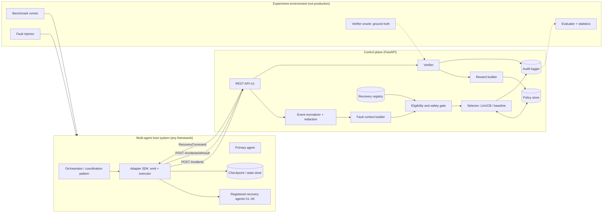
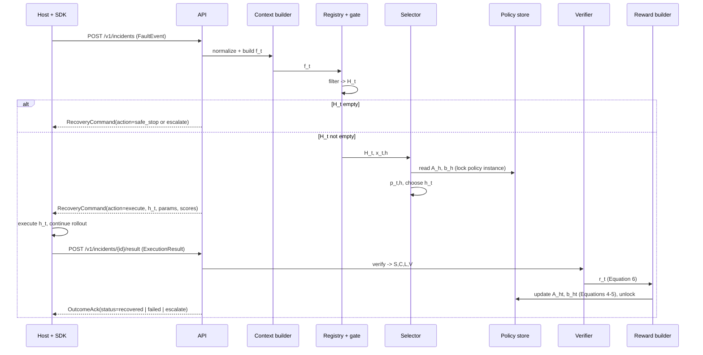

# System Architecture

> Status note: translated from the original implementation plan (October 2026). The code may have diverged from this plan; see docs/architecture for the current structure.

## 3.1 Components



## 3.2 Sequence of one incident (follows Figure 2 of the proposal)



Design note: the policy instance lock is held from the decision until the result is received **only in sequential experiment mode** (`strict_sequential=true`). In service mode, decisions are read without holding the lock and the update is applied when the result arrives (the update order is recorded in the audit). Experiment mode must use `strict_sequential=true`.

## 3.3 Incident state machine

```
RECEIVED -> CONTEXT_BUILT -> GATED -> { SAFE_STOPPED | ESCALATED | DECIDED }
DECIDED -> AWAITING_RESULT -> VERIFIED -> UPDATED -> { RECOVERED | FAILED }
AWAITING_RESULT -> CENSORED   (TTL expired, no update)
```

An illegal transition returns HTTP 409. The state machine is tested with a transition-table test (T-CORE-09).
